# ETH Gas Live

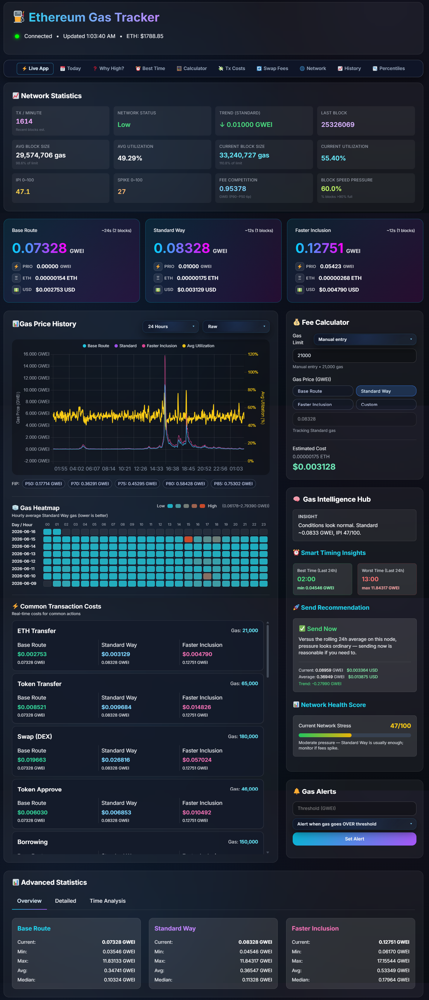

A gas quote is more useful when it helps answer a practical question: what might this transaction cost, and how does the current situation compare with recent conditions? ETH Gas Live brings live estimates, history and planning tools into one Ethereum dashboard.

## Tech stack

| Layer | Technologies |
|---|---|
| Application | PHP, WordPress |
| Supporting technologies | HTML, CSS, JavaScript; Chart.js; Ethereum |

## Read current transaction conditions

The main dashboard and send tiers give visitors an accessible view of current fee conditions. Network statistics add context to the estimate, while topic navigation helps explain the terms being shown. The aim is to support a decision rather than present an isolated number.

Base, Standard and Faster tiers give visitors a way to compare transaction choices. Reading them alongside network activity is more useful than treating one headline gas value as the whole picture.

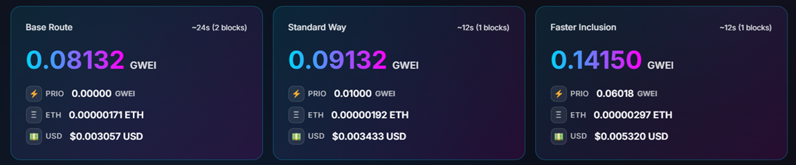

Network statistics add activity and utilisation context to the selected fee tiers. They help the visitor examine the conditions surrounding a proposed transaction instead of relying on price alone.

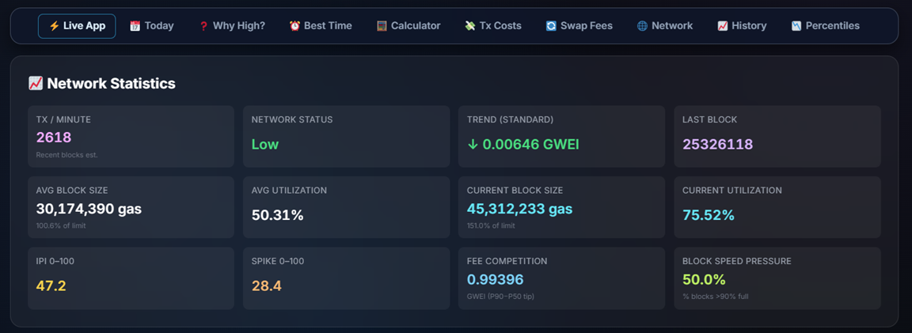

## Compare recent patterns

History charts and heatmaps help visitors examine how fee conditions change over time. They are useful for planning and understanding context around the latest reading. A historical pattern is information for the user, not a promise about the next block.

Use recent history for the current session and a wider view when reviewing recurring patterns. The heatmap complements the time series by making periods easier to compare visually.

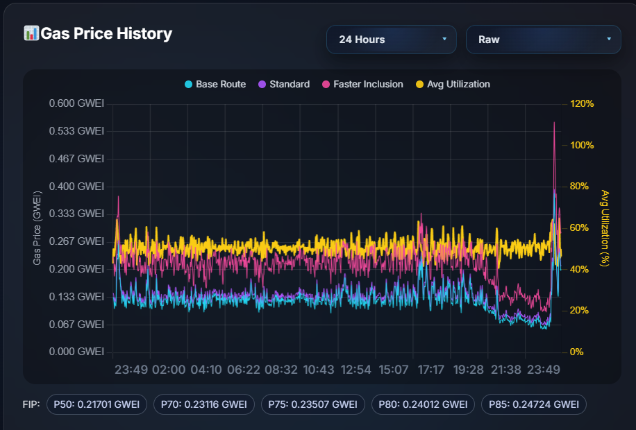

The heatmap organises historical conditions into a pattern that is easier to scan across periods. Use it to identify intervals for a closer look in the corresponding history.

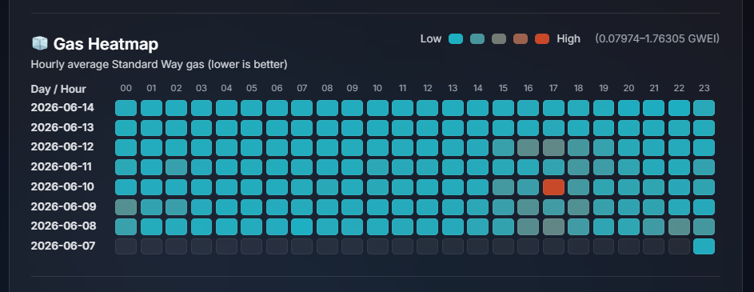

## Estimate a specific task

The fee calculator and common transaction-cost views help translate network conditions into the action the visitor has in mind. This makes the dashboard useful to someone planning a transfer or swap as well as someone simply observing the network.

A calculator is most useful when it connects the current fee conditions with the action being planned. Common transaction examples provide a starting point for estimating the relevant task.

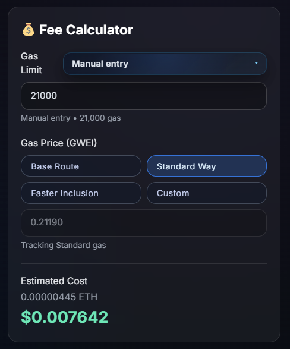

Common transaction-cost views connect the fee information with familiar Ethereum actions. They help a visitor compare tasks whose resource requirements differ.

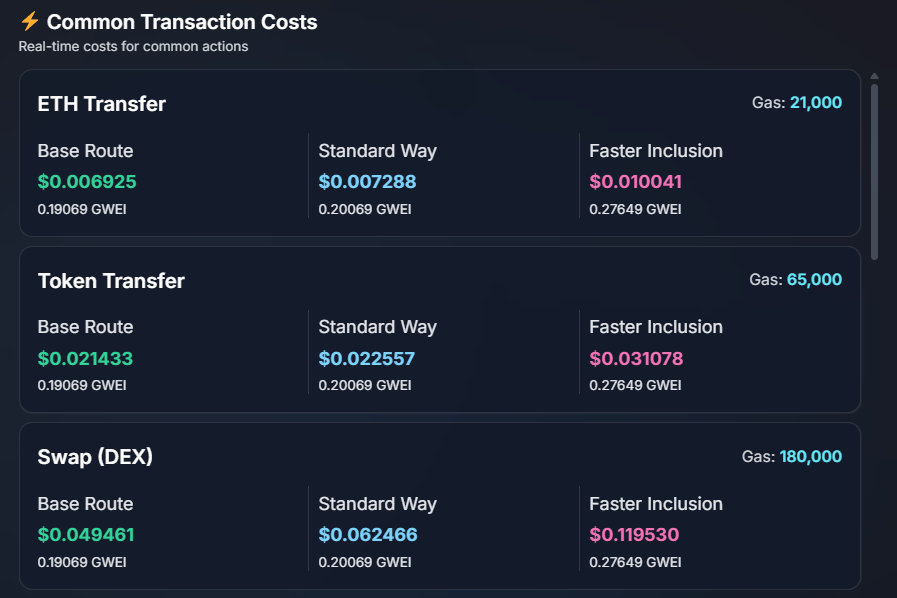

## Explore deeper statistics

The intelligence hub and advanced statistics provide more detail for visitors who want to investigate conditions further. Custom alerts help keep attention on a chosen threshold rather than continuously watching the page. Guides and dedicated topic pages offer another route into the information.

Visitors who need more detail can continue into the intelligence, timing and network views. Alerts provide a way to return when a chosen condition matters rather than watching the dashboard continuously.

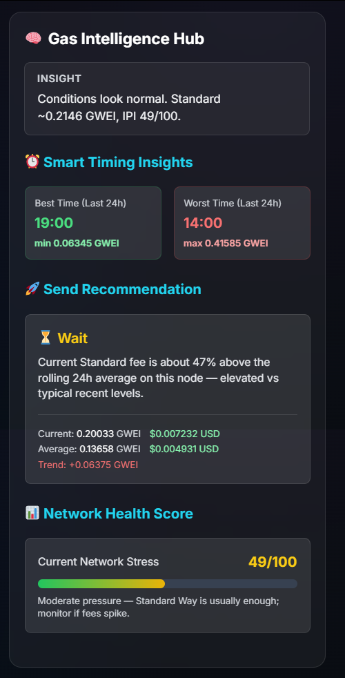

The statistics overview provides another entry point into the current network picture. It brings the measures used for a broader investigation into one readable view.

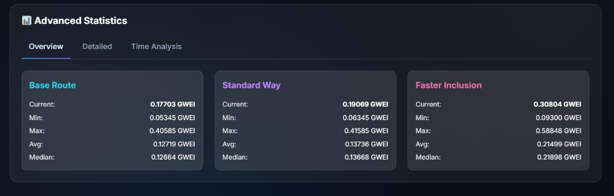

Detailed statistics support the questions that the headline tiers cannot answer alone. Continue into these views when a change in conditions needs more context.

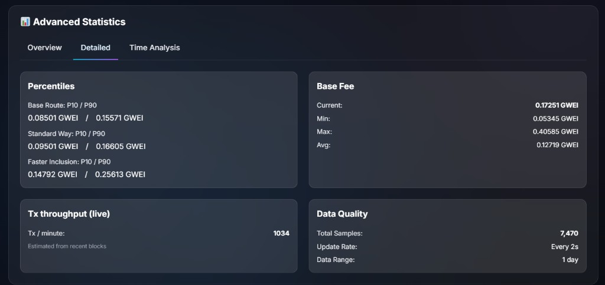

Time analysis connects the current observation with the periods around it. It is useful when the question concerns a pattern rather than the latest fee reading.

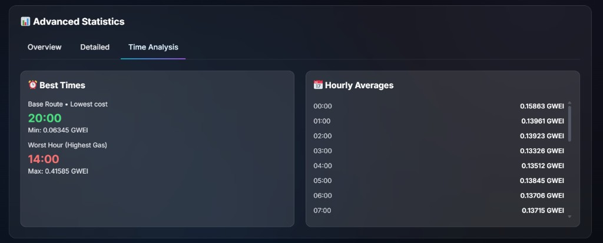

The dedicated gas-fees page gives readers a topic-focused way to approach the tracker. It connects the explanation with the current information relevant to that question.

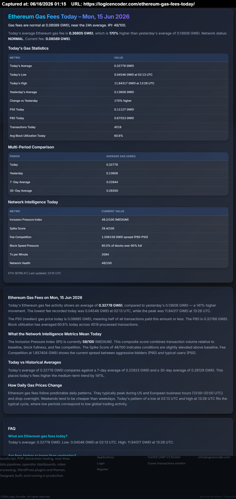

A swap-focused page narrows the discussion to a familiar transaction task. The reader can explore the fee context without beginning at the complete analytics workspace.

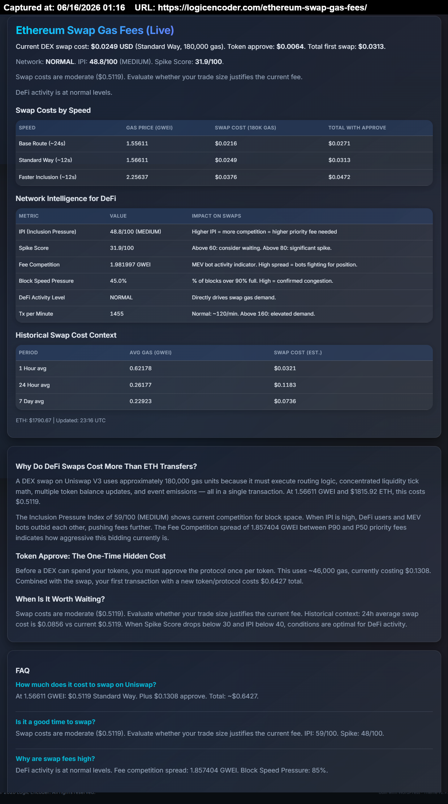

The network-status page provides a separate route into the broader activity picture. It supports readers who arrive with a network question rather than a specific fee calculation.

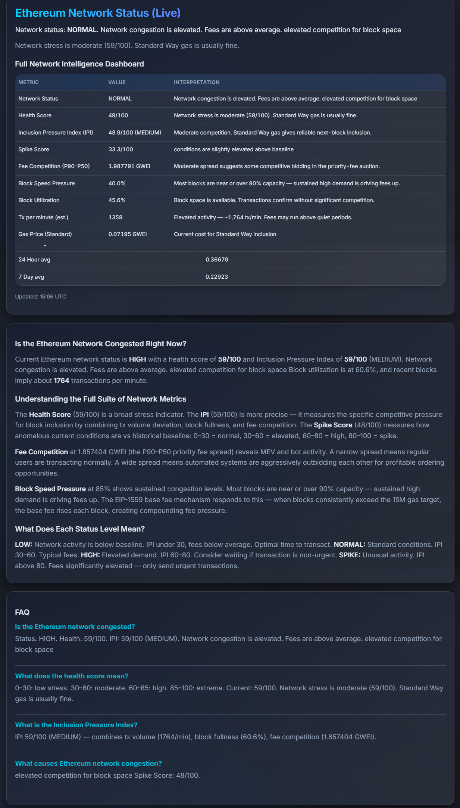

## Publish and operate the experience

WordPress embedding and site-operator tools support making the dashboard part of a wider site. Mission Control helps inspect the operating state.

The operator can review the state of the published dashboard separately from the visitor's fee-planning task. This keeps maintenance information available without turning the public experience into an administration screen.

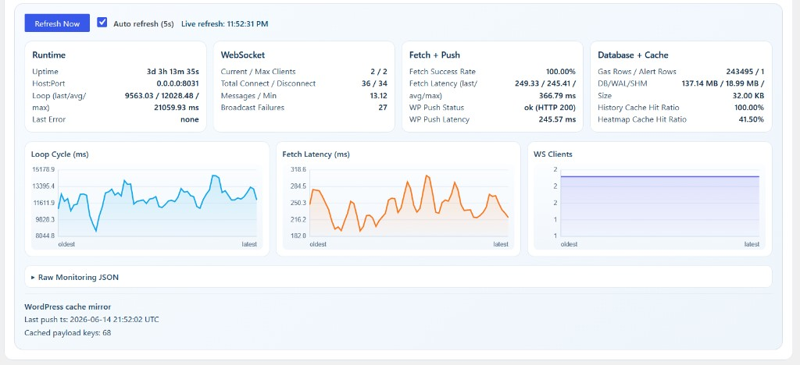

---

Private code: [eth-gas-live-plugin](https://github.com/logicencoder/eth-gas-live-plugin)

See [REPOS.md](REPOS.md) for related repositories.

**[Logic Encoder](https://logicencoder.com)** · [GitHub](https://github.com/logicencoder) · [Contact](https://logicencoder.com/contact/)
