# ETH Gas Live

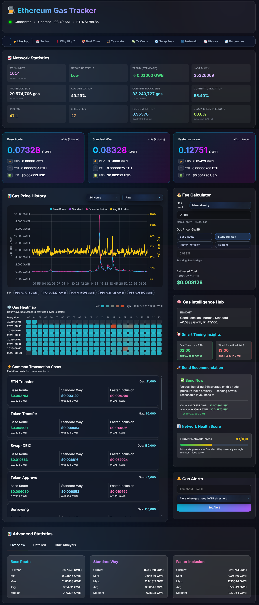

A gas quote is only useful when it answers a practical question: what will this transaction cost, and is now a good time? ETH Gas Live is a real-time Ethereum fee dashboard on [logicencoder.com](https://logicencoder.com) that turns every new block into three send tiers, a congestion read-out, history, a fee calculator and alerts, and explains the numbers on eleven dedicated pages. It is for anyone who sends, swaps or builds on Ethereum and wants to pay a fair fee instead of guessing.

## Tech stack

| Layer | Technologies |
|---|---|
| Application | PHP, WordPress |
| Supporting technologies | HTML, JavaScript; Chart.js and Tailwind CSS (both loaded from a public CDN); Ethereum |

## Read current transaction conditions

The main dashboard shows three send tiers per block: **Base Route** (economical), **Standard Way** and **Faster Inclusion**, each with a fee estimate that follows the EIP-1559 base fee and priority fee. Beside them sit **Percentiles** of recent fees, the base fee and a live transactions-per-block figure, and a **Network Health Score** that condenses congestion into one reading. A **Send Recommendation** says whether to send now or wait, and **Smart Timing Insights** point to cheaper moments. The figures come from the backend's own block analysis and are estimates, not guarantees of inclusion.

Base, Standard and Faster tiers give visitors a way to compare transaction choices. Reading them alongside network activity is more useful than treating one headline gas value as the whole picture.

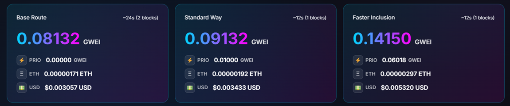

Network statistics add activity and utilisation context to the selected fee tiers. They help the visitor examine the conditions surrounding a proposed transaction instead of relying on price alone.

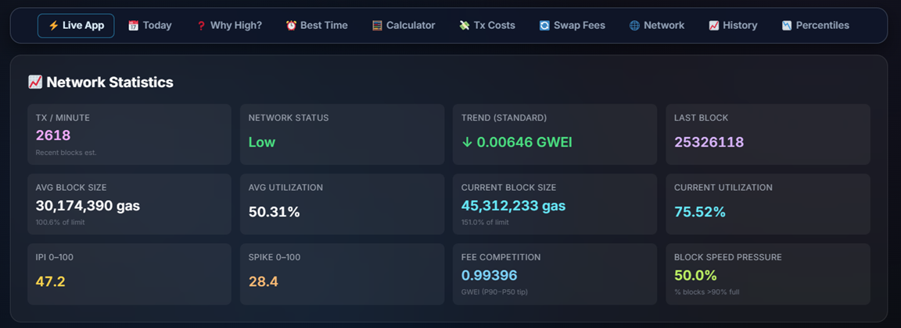

## Compare recent patterns

History charts show how fees moved over recent hours and days, and a heatmap lays the hours of the week out in a grid so the usually cheap and the usually expensive periods are easy to spot. **Best Times** and **Hourly Averages** summarise the pattern. A historical pattern describes the past; it makes no promise about the next block.

Use recent history for the current session and a wider view when reviewing recurring patterns. The heatmap complements the time series by making periods easier to compare visually.

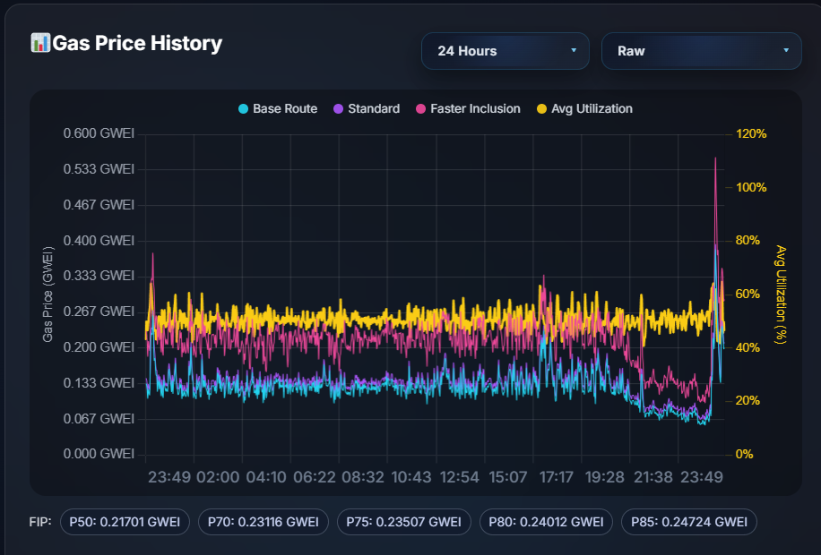

The heatmap organises historical conditions into a pattern that is easier to scan across periods. Use it to identify intervals for a closer look in the corresponding history.

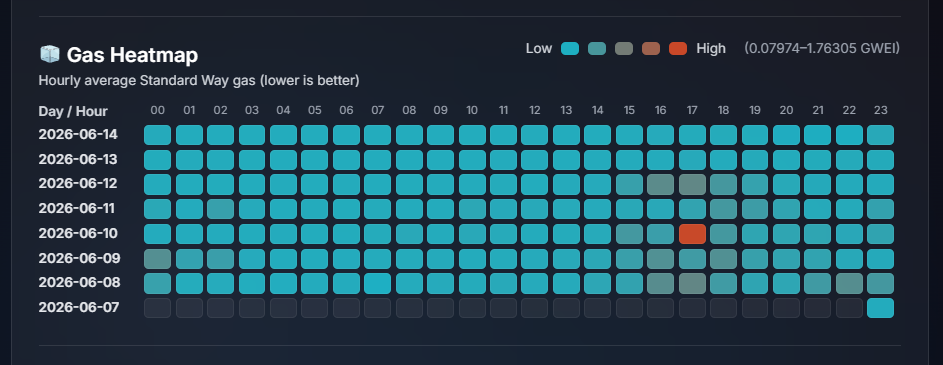

## Estimate a specific task

The **Fee Calculator** multiplies a gas limit by a gas price. The gas limit is chosen from presets for common actions (ETH Transfer 21,000, Token Transfer 65,000, Swap on a DEX 180,000, Token Approve 46,000, NFT Mint 180,000 and NFT Sale 150,000) or typed in by hand; the gas price follows the live Base Route, Standard Way or Faster Inclusion tier or can be set manually as a custom value, and the result is shown in ether and in dollars at the current ether price. Dedicated pages for transaction costs and swap fees start from the same numbers for the reader who arrives with that question.

A calculator is most useful when it connects the current fee conditions with the action being planned. Common transaction examples provide a starting point for estimating the relevant task.

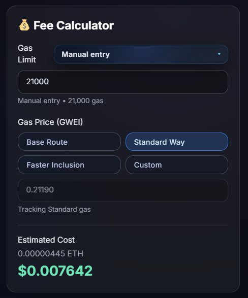

Common transaction-cost views connect the fee information with familiar Ethereum actions. They help a visitor compare tasks whose resource requirements differ.

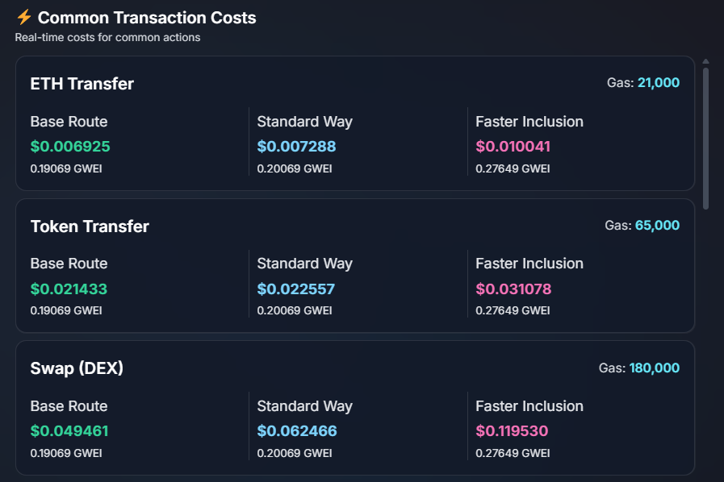

## Explore deeper statistics

**Network Statistics** has three tabs: an overview, detailed measures and a time analysis, and the backend adds a congestion index (Inclusion Pressure Index) and a spike score. **Gas Alerts** let a visitor enter a threshold in gwei and choose whether to be alerted when gas goes over it or under it. Alerts belong to the open page session and use the browser's notification permission, so they are meant for keeping a tab open while waiting for a cheaper moment. Eleven topic pages cover the live tracker, today's fees, why fees are high, the best time to send, a gas calculator, transaction costs, swap gas fees, a mempool view, network status, price history and percentiles.

Visitors who need more detail can continue into the intelligence, timing and network views. Alerts provide a way to return when a chosen condition matters rather than watching the dashboard continuously.

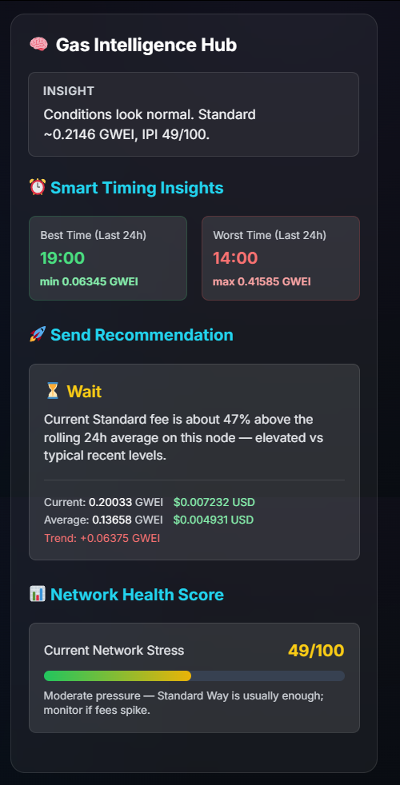

The statistics overview provides another entry point into the current network picture. It brings the measures used for a broader investigation into one readable view.

Detailed statistics support the questions that the headline tiers cannot answer alone. Continue into these views when a change in conditions needs more context.

Time analysis connects the current observation with the periods around it. It is useful when the question concerns a pattern rather than the latest fee reading.

The dedicated gas-fees page gives readers a topic-focused way to approach the tracker. It connects the explanation with the current information relevant to that question.

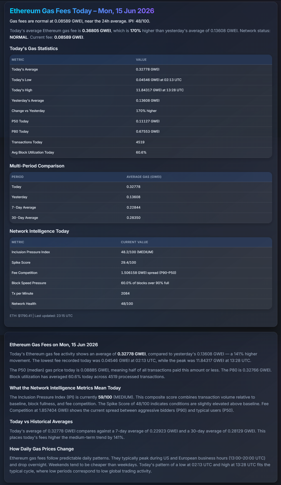

A swap-focused page narrows the discussion to a familiar transaction task. The reader can explore the fee context without beginning at the complete analytics workspace.

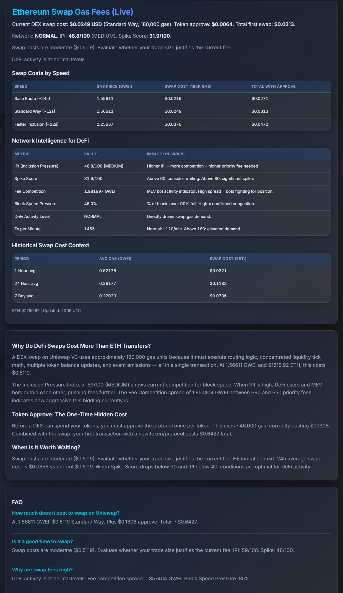

The network-status page provides a separate route into the broader activity picture. It supports readers who arrive with a network question rather than a specific fee calculation.

## Publish and operate the experience

WordPress embedding and site-operator tools support making the dashboard part of a wider site. Mission Control helps inspect the operating state.

The operator can review the state of the published dashboard separately from the visitor's fee-planning task. This keeps maintenance information available without turning the public experience into an administration screen.

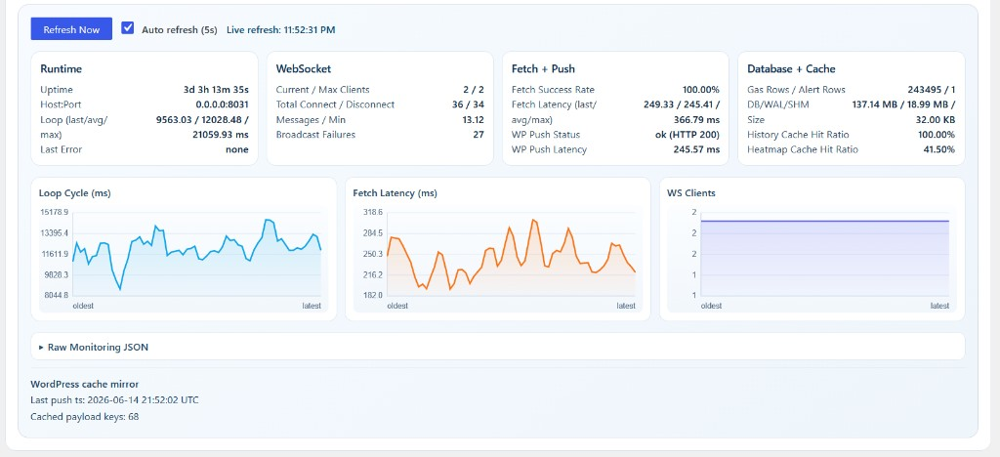

---

Private code: [eth-gas-live-plugin](https://github.com/logicencoder/eth-gas-live-plugin)

See [REPOS.md](REPOS.md) for related repositories.

**[Logic Encoder](https://logicencoder.com)** · [GitHub](https://github.com/logicencoder) · [Contact](https://logicencoder.com/contact/)
