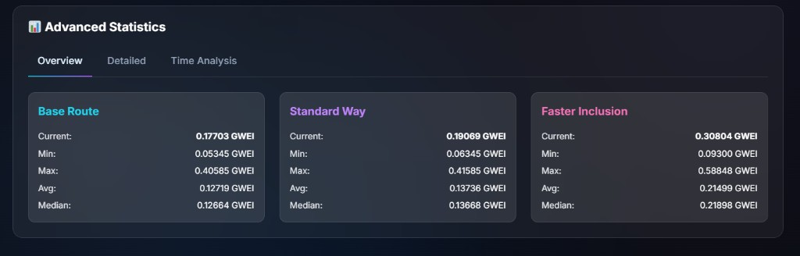
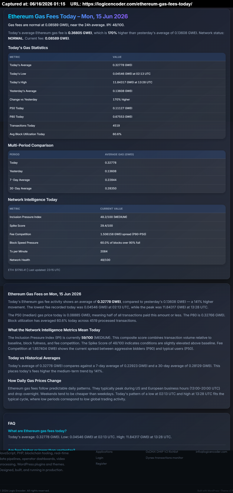
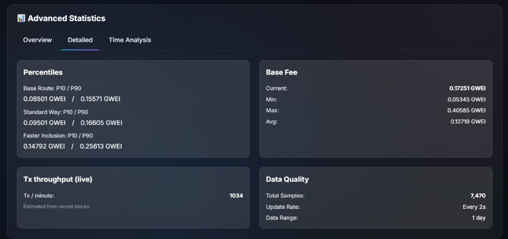
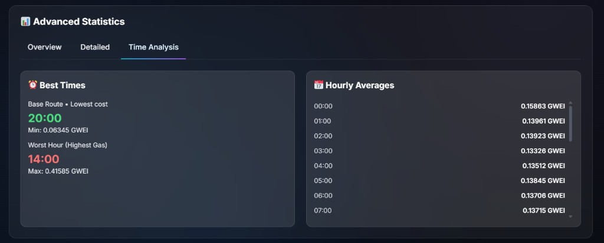
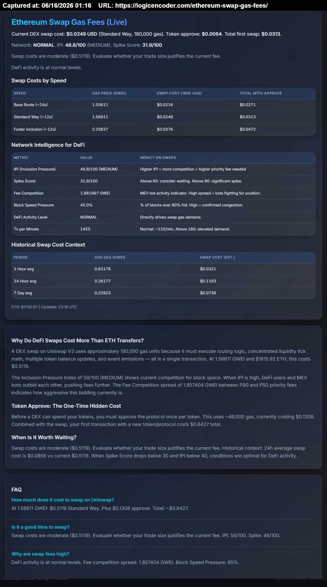
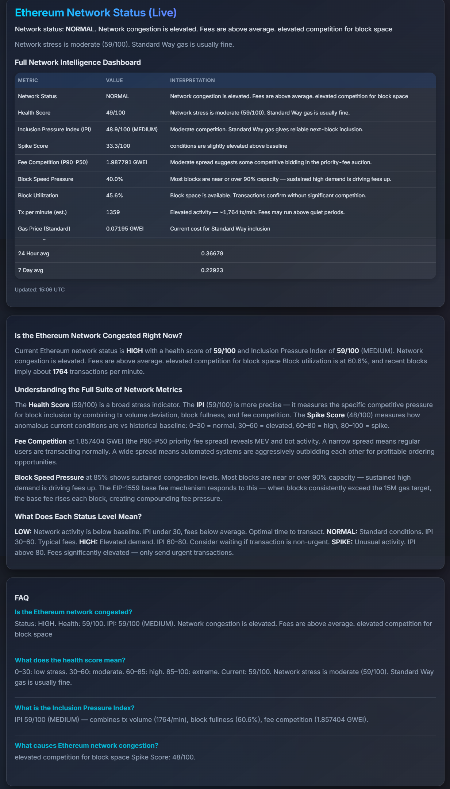
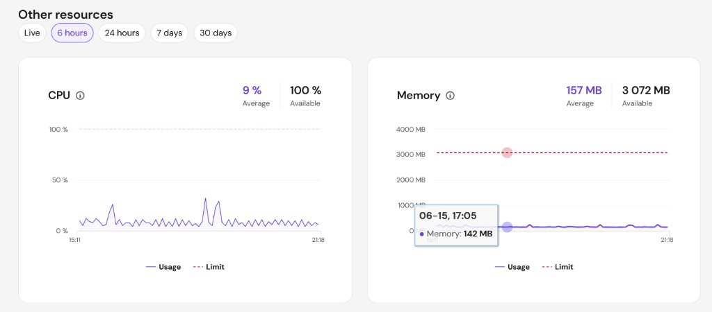

# ETH Gas Live

A gas quote is more useful when it helps answer a practical question: what might this transaction cost, and how does the current situation compare with recent conditions? ETH Gas Live brings live estimates, history and planning tools into one Ethereum dashboard.

## Tech stack

| Layer | Technologies |
|---|---|
| Application | PHP, WordPress |
| Supporting technologies | HTML, CSS, JavaScript; Chart.js; Ethereum |

## Read current transaction conditions

The main dashboard and send tiers give visitors an accessible view of current fee conditions. Network statistics add context to the estimate, while topic navigation helps explain the terms being shown. The aim is to support a decision rather than present an isolated number.

Base, Standard and Faster tiers give visitors a way to compare transaction choices. Reading them alongside network activity is more useful than treating one headline gas value as the whole picture.

Network statistics add activity and utilisation context to the selected fee tiers. They help the visitor examine the conditions surrounding a proposed transaction instead of relying on price alone.

## Compare recent patterns

When fees spike on social media — stay on **Live App**, click **Why fees high** or **Mempool** in the topic nav, read the explainer in the in-panel mount while tier cards keep updating; click **Live App** again to send when **Send Recommendation** flips favorable.

Use recent history for the current session and a wider view when reviewing recurring patterns. The heatmap complements the time series by making periods easier to compare visually.

Ethereum post-EIP-1559 pricing combines base fee and priority tips — senders trade off cost vs inclusion speed. The product surfaces **three named tiers** with clear labels:

The heatmap organises historical conditions into a pattern that is easier to scan across periods. Use it to identify intervals for a closer look in the corresponding history.

## Estimate a specific task

When your wallet shows three opaque speeds — map **low / medium / high** to **Base Route / Standard Way / Faster Inclusion** here first. Competitive NFT mint with a short window → watch **Faster Inclusion** and **fee competition**; routine ERC-20 send when **network status** is **LOW** or **NORMAL** → **Base Route** is usually enough if the **~24s (2 blocks)** hint is acceptable.

A calculator is most useful when it connects the current fee conditions with the action being planned. Common transaction examples provide a starting point for estimating the relevant task.

Common transaction-cost views connect the fee information with familiar Ethereum actions. They help a visitor compare tasks whose resource requirements differ.

## Explore deeper statistics

Standard spiked in the last ten minutes — if **tx/min** and **current utilization** climbed together and **SPIKE** is elevated, treat it as real congestion; if only **last block** is fat while averages stay calm, wait one block before overpaying on **Faster Inclusion**.

Visitors who need more detail can continue into the intelligence, timing and network views. Alerts provide a way to return when a chosen condition matters rather than watching the dashboard continuously.

The statistics overview provides another entry point into the current network picture. It brings the measures used for a broader investigation into one readable view.

Detailed statistics support the questions that the headline tiers cannot answer alone. Continue into these views when a change in conditions needs more context.

Fees jumped in the last half hour → set **1 Hour** + **Raw**, watch **Standard** climb alongside **Avg Utilization** → real congestion. Switch to **7 Days** → if today’s band sits above the weekly cloud, wait or use **Base Route**; if only the last hour is hot, one block of patience often enough.

Open **3 Hours** + **Raw**, watch **Faster Inclusion** vs **Standard** spread widen → mempool is competitive; if the spread is flat, **Standard Way** usually lands without **Faster** pricing. Cross-check **fee competition** in the network grid before you overpay in the wallet.

Set **24 Hours** or **7 Days**, find where **Standard** spent most of its time below your comfort line → line that window up with the **heatmap** below and submit the batch in that band using **Base Route** unless **IPI** is elevated.

The dedicated gas-fees page gives readers a topic-focused way to approach the tracker. It connects the explanation with the current information relevant to that question.

Directly under the history chart, the **heatmap** answers *when* to send as well as *how much* right now. It colors **hourly average Standard Way gas** over the last **seven days** (thirty days when the history range selector is on the **30 Days** window). **Darker cells** = cheaper hours; **brighter cells** = expensive windows.

Hours shift to **your browser timezone** — a cheap European evening shows in local time rather than UTC. Hover a cell for the exact hour and average gwei behind the color.

Find the weekday row you usually pay on → note the consistently dark column (same local hour each week) → open the wallet in that window with **Base Route** → skip bright columns that match US/EU business-hour peaks.

Pick your target hour band from the heatmap → set an **UNDER** alert near the top of that band → allow browser notifications → when the alert fires, confirm on the **1 Hour** chart that fees are still in the cheap band, then submit.

Dark cell on the heatmap but **Send Recommendation** still says wait → check **IPI** and **Worst Time (Last 24h)** — historical cheap hour does not override an active spike; defer until the hub flips or **SPIKE** drops in the network grid.

WordPress embedding and site-operator tools support making the dashboard part of a wider site. Mission Control helps inspect the operating state.

The operator can review the state of the published dashboard separately from the visitor's fee-planning task. This keeps maintenance information available without turning the public experience into an administration screen.

**Insight** — one-sentence network readout tied to current IPI and spike state (plain language, not raw numbers only).

**Smart Timing Insights** — **Best Time (Last 24h)** and **Worst Time (Last 24h)** cards with hour labels and average Standard gwei for each window. Use them to defer non-urgent sends to historically cheaper hours.

**Send Recommendation** — actionable badge (send now vs consider waiting) with supporting copy, plus a comparison strip: **current Standard gwei and USD** vs **24h average**, and a **trend** line showing how far today sits from the mean. This is the same logic behind the one-line “send / wait” guidance, expanded for readers who want numbers behind the verdict.

**Network Health Score** — **Current Network Stress** as a 0–100 score with a gradient bar (green → yellow → red) and a short advice line below. Pairs with IPI in the network grid — the hub version is optimized for quick glances on narrow screens.

The hub recomputes on every payload tick using the same backend scoring as charts and SEO pages, so guidance stays consistent across panels.

**Send Recommendation** shows “consider waiting”, **current Standard** sits above **24h average**, and **Worst Time (Last 24h)** is still hours away — batch your non-urgent transfers for the **Best Time** window instead of submitting now on **Standard Way**.

### Fee calculator

The **fee calculator** answers “how much will *my* transaction cost?” beyond the reference transfer on the tier cards.

- **Gas limit presets** — ETH transfer, ERC-20 transfer, DEX swap, token approve, NFT mint, NFT sale; or type a custom limit if you know units from a contract simulation.
- **Tier selector** — price from Base Route, Standard Way, Faster Inclusion, or **custom gwei** for what-if scenarios; “Auto (Standard)” tracks live Standard when you do not want to babysit the field.
- **Live output** — instant ETH and USD fee estimate updating with each WebSocket tick when a tier is selected.

Power users cross-check wallet simulation quotes; newcomers use presets so they do not have to know that a swap is ~180k gas.

MetaMask quotes a swap — pick **Swap (DEX)** preset, leave tier on **Auto (Standard)**, read **Estimated Cost** in USD; switch tier to **Faster Inclusion** to see the cost of jumping the queue if the swap is time-sensitive.

### Common transaction costs

The **featured transaction costs** list shows real-time estimates for **nineteen action types** at **all three tiers** side by side — ETH transfer, token transfer, approve, DEX swap, NFT mint/sale, bridging, borrowing, lending, staking, unstaking, claim rewards, compound, liquidity add/remove, governance vote, multi-send, contract creation, and contract deployment.

Each row displays the action name, **gas limit** used for the estimate, and **Base / Standard / Faster** columns in both USD and gwei. Useful when planning multi-step workflows (approve + swap + bridge) where you only care about total dollars, not manual gwei math. The scrollable list keeps priority actions (transfer, swap, approve) at the top.

For a three-step DeFi exit — note **Token Approve**, **Swap (DEX)**, and **Bridging** rows at **Standard Way** USD, add the three numbers for a rough total before you open the wallet; if the sum hurts, check whether **Base Route** on the approve step is acceptable while keeping **Faster** only on the swap step.

### Advanced statistics

Three in-app sub-tabs for researchers who want tables alongside the charts:

**Overview** — current, min, max, average, and median gwei per tier for the selected history window. Quick answer to “how bad was today vs the week?”

**Detailed** — percentile breakdowns (P10/P50/P90), base fee stats, live tx throughput, sample quality indicators, and **IPI** history snippets. Use when writing up network conditions or verifying a spike was real in the data.

**Time Analysis** — best and worst hour plus a full **hourly averages** table for the period. Pairs with the heatmap for exact numbers behind the colors.

When writing a “gas post-mortem” after a busy day — **Detailed** tab for P90 vs P50 spread, **Time Analysis** for the exact worst hour to cite, **Overview** for min/max/median per tier in one glance.

### Custom alerts

The **Gas Alerts** panel lets you set a **gwei threshold** and choose **Alert when gas goes OVER threshold** or **Alert when gas goes UNDER threshold** — useful for “notify me when fees drop enough to batch payouts” or “warn me before fees spike past my budget.”

Alerts are stored per **browser session** on the backend; the list shows active rules with delete actions. When a rule fires, the UI shows an on-screen toast and, if you granted permission, a **browser notification** with current vs threshold gwei and USD equivalents. The WebSocket stream delivers alert events in realtime so you do not need to keep the tab focused.

If you will not babysit the tab — allow browser notifications, set **UNDER** at your target Standard gwei, keep the tab open in the background (or pinned); when fees drop, submit the batch payout from the wallet using **Base Route** or **Standard Way** as **Send Recommendation** suggests.

## SEO topic pages

Eleven indexable URLs on logicencoder.com are filled with **live data** from the backend bundle. WordPress serves local HTML templates; placeholders are replaced from the backend SSR data bundle (refreshed on a short transient cache). Each page targets a search intent and links back to the main tracker:

| Page | URL | Intent |
|------|-----|--------|
| Gas hub | [ethereum-gas](https://logicencoder.com/ethereum-gas/) | Overview landing |
| Fees today | [ethereum-gas-fees-today](https://logicencoder.com/ethereum-gas-fees-today/) | “What do fees look like right now?” |
| Why fees high | [why-are-ethereum-gas-fees-high](https://logicencoder.com/why-are-ethereum-gas-fees-high/) | Explainers during spikes |
| Best time | [best-time-to-send-ethereum](https://logicencoder.com/best-time-to-send-ethereum/) | Scheduling sends |
| Calculator | [ethereum-gas-calculator](https://logicencoder.com/ethereum-gas-calculator/) | Landings for “gas calculator” queries |
| Tx costs | [ethereum-transaction-costs](https://logicencoder.com/ethereum-transaction-costs/) | Per-action comparisons |
| Swap gas | [ethereum-swap-gas-fees](https://logicencoder.com/ethereum-swap-gas-fees/) | DeFi-specific |
| Mempool | [ethereum-mempool-tracker](https://logicencoder.com/ethereum-mempool-tracker/) | Queue / load context |
| Network status | [ethereum-network-status](https://logicencoder.com/ethereum-network-status/) | Health dashboard for search |
| History | [ethereum-gas-price-history](https://logicencoder.com/ethereum-gas-price-history/) | Long-range charts |
| Percentiles | [ethereum-gas-percentiles](https://logicencoder.com/ethereum-gas-percentiles/) | Statistical deep dive |

**Embed mode** (`?gt_embed=1`) serves a chromeless view for in-app panels and third-party iframes without WordPress theme chrome. The retired `/ethereum-gas-tracker-live/` path returns gone — the canonical live URL is `/ethereum-gas-tracker/`.

### Gas fees today (SEO page)

The **[ethereum-gas-fees-today](https://logicencoder.com/ethereum-gas-fees-today/)** landing is a dated article-style page filled from live backend data on each publish. Three tables anchor the page:

- **Today’s Gas Statistics** — today’s average, low/high with UTC hour, yesterday comparison, P50/P80, transaction count, avg block utilization.
- **Multi-Period Comparison** — today vs yesterday vs **7-day** and **30-day** averages in one row.
- **Network Intelligence Today** — IPI, spike score, fee competition, block speed pressure, tx/min, network health score, ETH/USD and last-updated footer.

Prose sections below explain how daily patterns work (US/EU business-hour peaks vs overnight lulls). FAQ blocks answer “what are fees today?” in plain language for search snippets.

When you landed from Google on “gas fees today” — read **Multi-Period Comparison** first: if today sits far above **7-Day Average**, open the live tracker’s **7 Days** chart before sending; click **Live App** in the topic nav to watch tiers update in realtime.

### Swap gas fees (SEO page)

**[ethereum-swap-gas-fees](https://logicencoder.com/ethereum-swap-gas-fees/)** targets DeFi swap queries. **Swap Costs by Speed** lists Base / Standard / Faster with gwei, swap-only USD, and **total with approve** (first-time DEX users often miss the one-time approval). **Network Intelligence for DeFi** explains IPI, spike score, fee competition, block speed pressure, DeFi activity level, and tx/min with an **Impact** column. **Historical Swap Cost Context** compares 1h / 24h / 7d average swap cost.

Educational sections cover why swaps cost more than transfers (~180k gas), the hidden approve step (~46k gas), and when waiting beats swapping (spike score and IPI thresholds in the copy).

When planning your first Uniswap trade — read **total with approve** on **Standard Way** before you set slippage; if **Spike Score** impact says consider waiting above 60, defer and set an **UNDER** alert on the live dashboard instead of forcing the swap.

### Network status (SEO page)

**[ethereum-network-status](https://logicencoder.com/ethereum-network-status/)** is the health dashboard for “is Ethereum congested?” searches. A **Full Network Intelligence Dashboard** table lists network status, health score, IPI, spike score, fee competition, block speed pressure, block utilization, tx/min, Standard gwei, 24h/7d averages, and timestamp — each with an **Interpretation** column. Long-form copy defines **LOW / NORMAL / HIGH / SPIKE** regimes and what each means for send timing (same scale as the live grid’s **Network status** cell).

For a non-urgent transfer while status reads **HIGH** — read the interpretation for **Block utilization** and **IPI**; if both elevated, use **Best Time** or the heatmap on the live app rather than submitting on **Faster Inclusion** immediately.

## WordPress embedding

Shortcode **`[eth_gas_dashboard]`** drops the same dashboard shell into any WordPress page or post. The plugin handles dedicated routing for `/ethereum-gas-tracker/`, **LiteSpeed / full-page cache bypass** on all gas routes (stale gwei on cached HTML is unacceptable), and a REST mirror of the latest payload that the backend can push every block.

Editors embed the live tool inside articles (“check fees below”) without maintaining a separate iframe host. Activation creates the SEO page records and stores their IDs so template routing survives theme changes.

## Site operator tools

In wp-admin, **ETH Gas Live** includes **Mission Control** — production observability without SSH.

**Runtime card** — backend uptime, host/port, ingest loop timing (last/avg/max ms), last error string. Loop spikes often precede stale public data.

**WebSocket card** — current and max connected clients, total connect/disconnect lifetime counts, messages per minute, broadcast failure counter. If failures climb while clients are high, check network or payload size.

**Fetch + Push card** — RPC fetch success rate, fetch latency (last/avg/max), WordPress push HTTP status and latency. Confirms the Python → WordPress mirror path that keeps REST fallback fresh.

**Database + Cache card** — gas history row count, alert row count, SQLite file sizes (DB/WAL/SHM), history and heatmap cache hit ratios. Low hit ratio after deploy may mean cold cache, not broken ingest.

Three rolling **charts** plot loop cycle ms, fetch latency ms, and WS client count. Expandable **raw monitoring JSON** for copying into tickets. **WordPress cache mirror** footer shows last push timestamp and cached payload key count.

Settings above Mission Control configure API base URL, WebSocket URL, public asset base for CSS rewrite, push API key, and client refresh interval — change endpoints after infra moves without editing code.

When users report stale tiers but WS shows connected — check **Fetch + Push** for failed WordPress push or rising fetch latency; if **last push timestamp** on the WP mirror footer is old, fix push key or API base URL in settings before touching PHP.

## Shared hosting headroom

Gas math and WebSocket fan-out run off shared hosting; WordPress only serves the SPA shell, SEO templates, and the REST mirror. After offloading ingest and fan-out, shared-hosting CPU and memory stay well below plan limits while the live tracker runs.

Private code: [eth-gas-live-plugin](https://github.com/logicencoder/eth-gas-live-plugin) · live data [eth-gas-live-backend](https://github.com/logicencoder/eth-gas-live-backend)

Backend overview: [eth-gas-live-backend-overview](https://github.com/logicencoder/eth-gas-live-backend-overview)

See [REPOS.md](REPOS.md).

---

Private code: [eth-gas-live-plugin](https://github.com/logicencoder/eth-gas-live-plugin)

See [REPOS.md](REPOS.md) for related repositories.

**[Logic Encoder](https://logicencoder.com)** · [GitHub](https://github.com/logicencoder) · [Contact](https://logicencoder.com/contact/)
